<p align="center">
  
</p>

<h1 align="center">OMAC</h1>
<p align="center"><strong>Organizador Mensal de Arquivos Contábeis</strong><br>
Aplicativo para Windows que automatiza a rotina contábil mensal de uma clínica odontológica.</p>

<p align="center">
  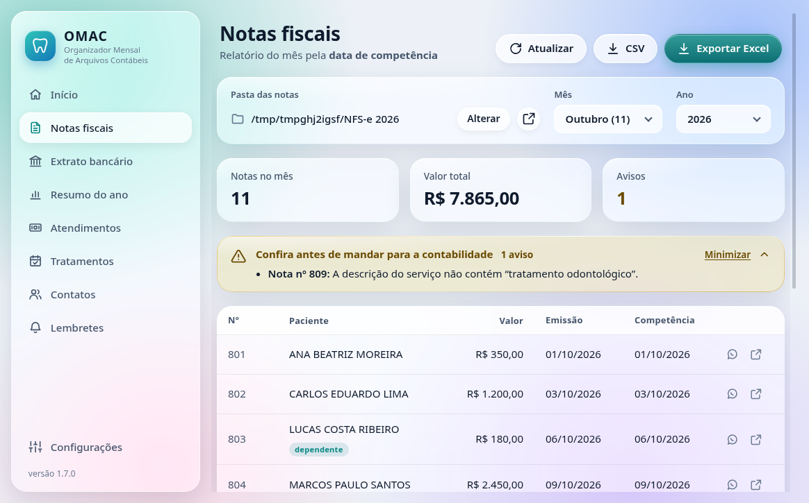
  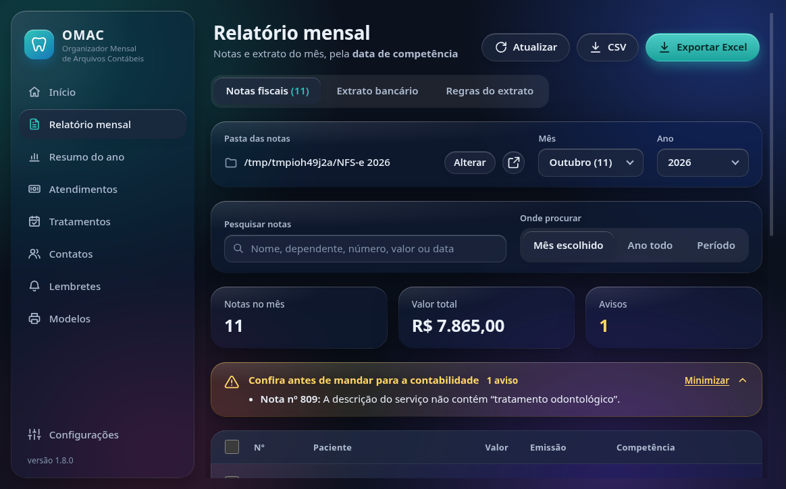
</p>

> Todas as imagens usam **notas de exemplo geradas pelo próprio projeto**. Nenhum dado real de paciente está neste repositório.

## O problema

Todo fim de mês as notas fiscais de serviço (NFS-e) emitidas no ISS do DF e cada linha do
extrato do banco precisavam ser passadas à mão para uma planilha que vai para a contabilidade.

## O que o OMAC faz

### Início

<p align="center">
  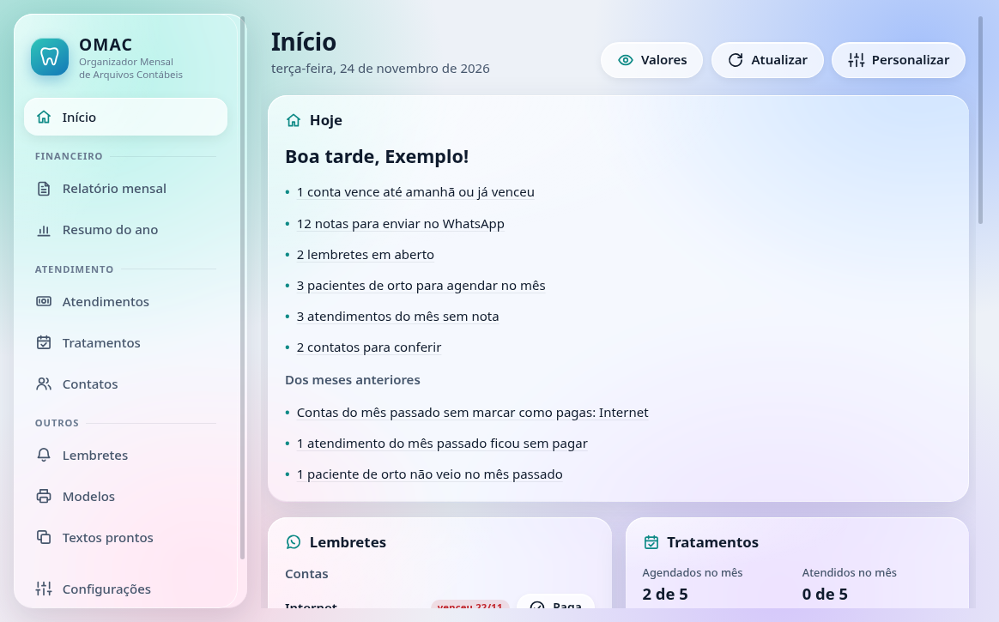
  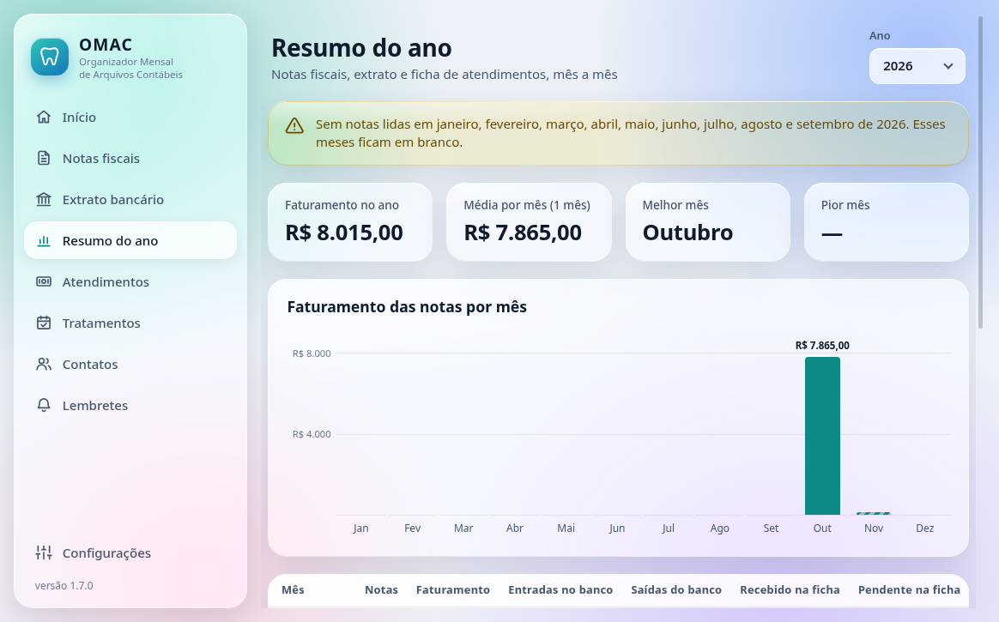
</p>

- **O dia numa tela só, em widgets:** Hoje, Lembretes (contas que vencem, com o botão **Paga** ali mesmo, notas a enviar e lembretes em aberto), Tratamentos, Atendimentos do mês, Relatório mensal (o fechamento do mês anterior), Contatos, Resumo do ano e Modelos (com o botão **Imprimir**).
- **Hoje:** junta o que está para hoje em todos os módulos, as pendências dos meses anteriores e o aviso de backup atrasado ou com falha. Cada linha leva direto para a tela certa.
- **Personalizável:** no botão **Personalizar** dá para arrastar os widgets (ou usar as setas, pelo teclado), esconder os que não interessam e deixar um widget largo. Nas Configurações escolhe-se abrir o app no Início ou direto no Relatório mensal.

### Resumo do ano

- **Faturamento das notas mês a mês** em gráfico, com o total, a média por mês, o melhor e o pior mês e a comparação com o mês anterior.
- **Tabela completa:** notas, faturamento, entradas e saídas do banco e o recebido e pendente da ficha de atendimentos.
- **Mês sem dado fica em branco**, com um aviso de quais meses não têm nota lida. O mês atual não entra na média, porque ainda não acabou.

### Relatório mensal

Notas fiscais, extrato bancário e as regras do extrato em abas de uma tela só, com **um seletor de mês só**: trocar o mês numa aba vale para as outras.

<p align="center">
  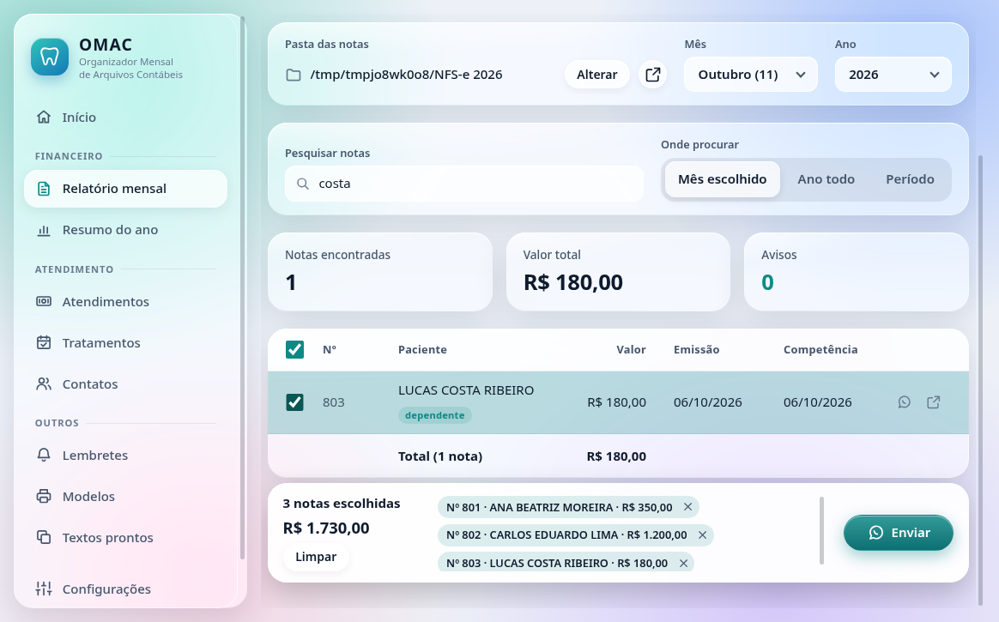
  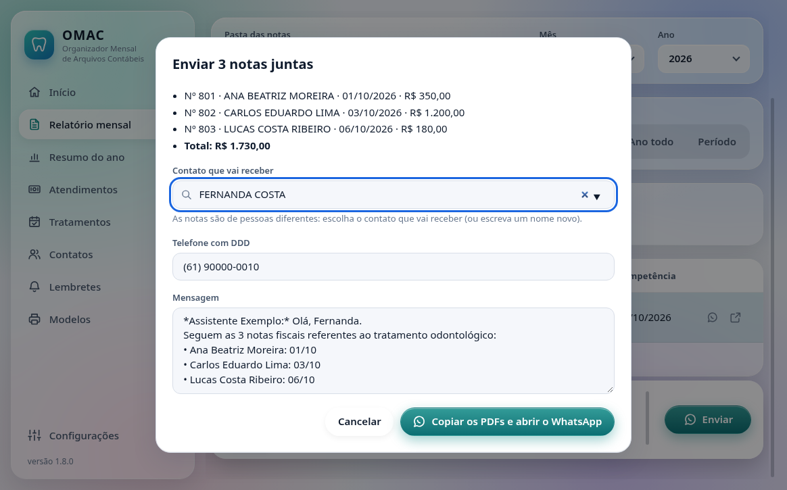
</p>

#### Notas fiscais

- **Lê a pasta de PDFs das notas do ano** (ex.: `NFS-e 2026`) e monta a planilha do mês em um clique, em **Excel (.xlsx)** ou **CSV**.
- **Filtra pela data de competência**, não pela de emissão. Uma nota emitida em 03/11 com competência em outubro entra no relatório de outubro.
- **Nome do paciente:** vem do nome do arquivo. Se a descrição do serviço disser *"tratamento odontológico referente ao dependente FULANO"*, o nome do dependente tem prioridade (caso de nota no CPF do responsável).
- **Notas canceladas** ficam fora do relatório e são movidas sozinhas para a subpasta `Canceladas`.
- **Avisos antes de mandar para a contabilidade:** descrição sem "tratamento odontológico", número do arquivo diferente do número da nota, nota repetida, PDF ilegível, nome de arquivo fora do padrão.
- **Rápido em PC antigo:** cada nota é lida uma única vez (≈5 ms) e fica em cache. Nas próximas vezes, só as notas novas são lidas.
- **Notas novas chegam sozinhas:** emitiu a nota e salvou o PDF, ao voltar para o OMAC ele confere a pasta (só nome, tamanho e data dos arquivos, em milésimos de segundo) e, se mudou, lê só o que é novo e avisa: *“1 nota nova: nº 245 – Fulano”*. Nada fica vigiando a pasta enquanto o OMAC está parado. Dá para desligar nas Configurações e usar só o botão **Atualizar**, que também está em Atendimentos. No canto da aba aparece a hora da última leitura (*“Notas lidas às 14:32”*).
- **Renomear o PDF baixado:** o site da nota baixa o PDF com um nome só de números (*589129308401233923233.pdf*). Quando um PDF assim chega (ou um com o número errado no nome), o OMAC avisa e oferece **Renomear** com o nome certo, montado com o número, as datas e o nome de quem recebe a nota que estão **dentro do PDF** (o nome sai como está nos Contatos, quando dá para achar pelo CPF ou pelo nome), no formato das Configurações: *NFS-e Nº 000000013 - Fulana de Tal - 23-11 - COMP 21-11.pdf*. O nome aparece antes e dá para mudar; o OMAC nunca passa por cima de outro arquivo. O botão também fica na faixa de avisos.
- **Pesquisa num campo só:** nome do paciente ou do responsável, dependente, número, valor (`150`, `1.500,00`) ou data (`05/10`, `10/2026`). Cada palavra precisa aparecer na nota (`maria 150`). Procura no mês escolhido, no ano todo ou num período (de–até), sempre pela competência.
- **Escolher várias notas:** uma caixa em cada nota. A escolha não se perde ao pesquisar de novo, e fica numa ilha presa embaixo da tela, com o total, o **x** para tirar uma nota e o botão **Enviar**.
- **Enviar várias de uma vez:** se as notas são da mesma pessoa, o contato dela (ou de um responsável) já vem escolhido; se são de pessoas diferentes, escolhe-se o contato na lista. Uma mensagem só lista as notas, e **todos os PDFs vão juntos para a área de transferência**: um <kbd>Ctrl</kbd> + <kbd>V</kbd> na conversa cola todos. Depois o OMAC pergunta se marca todas como enviadas.
- **Colar sozinho (experimental, desligado de início):** no WhatsApp do computador, o OMAC espera a conversa aparecer e aperta <kbd>Ctrl</kbd> + <kbd>V</kbd>. Só cola se a janela da frente for mesmo o WhatsApp. O Enter é sempre da pessoa.

#### Extrato bancário

<p align="center">
  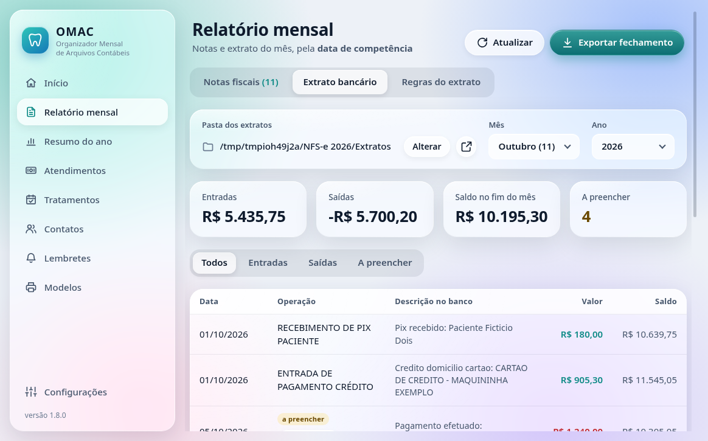
  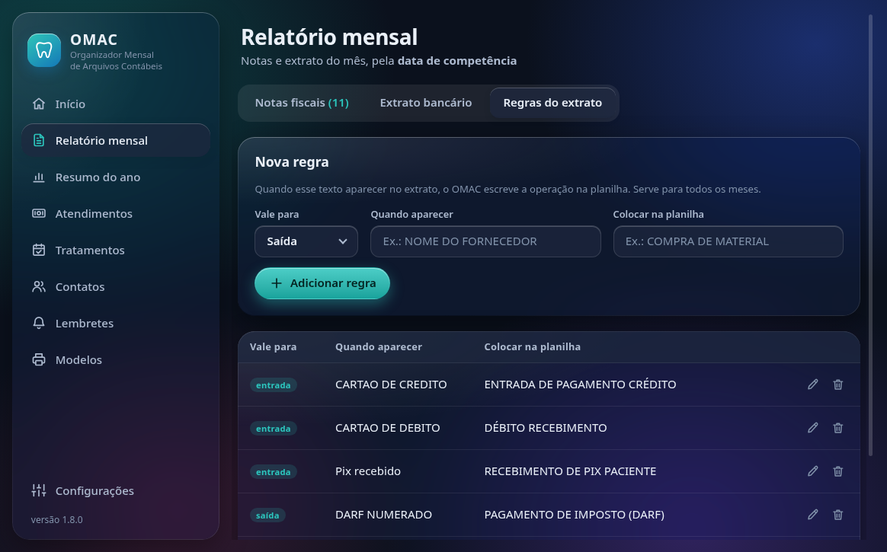
</p>

- **Lê os extratos em PDF do Banco Inter** de uma pasta e junta tudo. Se os períodos se repetirem, cada dia vem do extrato baixado por último.
- **Regras "quando aparecer X, colocar Y"** preenchem a coluna Operação. As entradas (Pix, crédito e débito) já vêm prontas; as saídas sem regra ficam em amarelo para preencher, e dá para criar a regra a partir da própria linha.
- **Confere pelo saldo:** cada lançamento é checado com o saldo que o banco informa. Se faltar um período e o saldo tiver mudado nele, o OMAC avisa quanto ficou de fora.
- **Fechamento do mês em um arquivo só:** abas de extrato, notas e resumo por operação, com fórmulas que acompanham o que for digitado depois.

### Lembretes

<p align="center">
  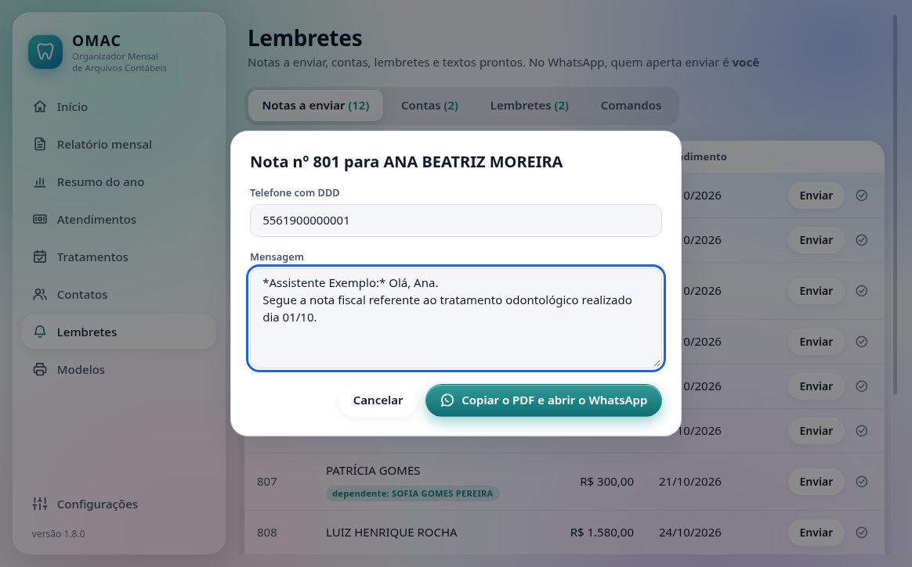
  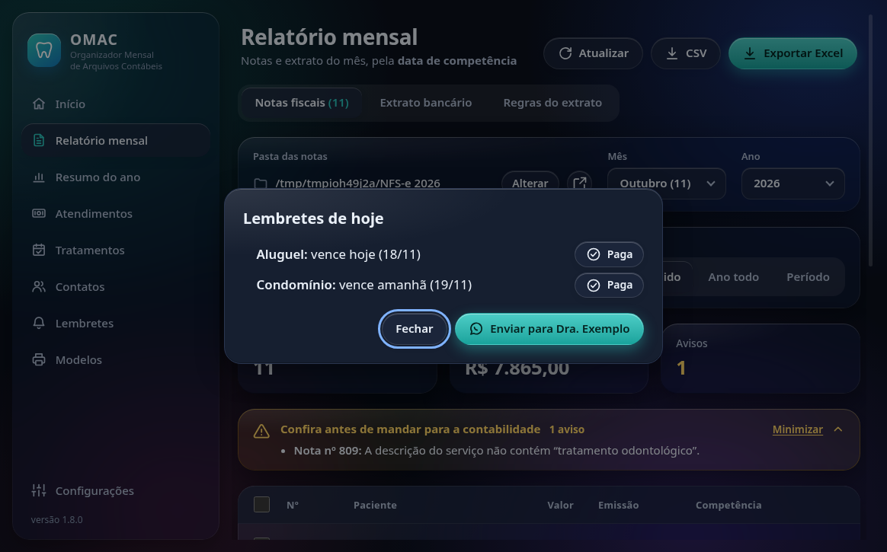
</p>

<p align="center">
  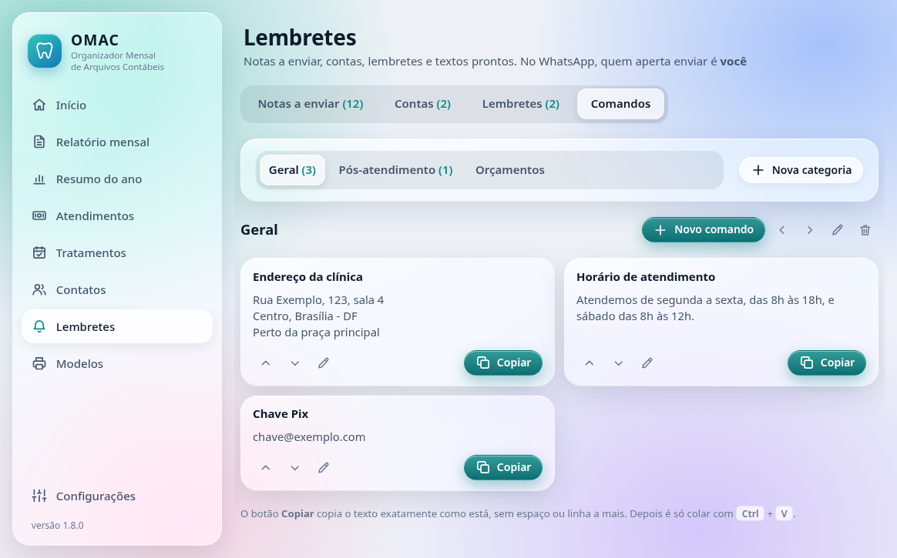
  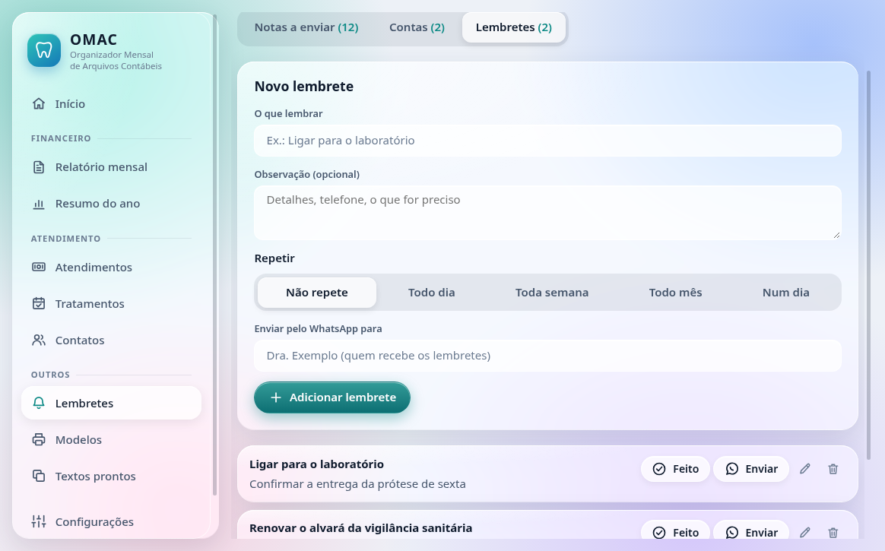
</p>

- **Mensagem do seu jeito:** em Configurações → WhatsApp, o texto da nota (e o de várias notas juntas) é escrito com variáveis como `[primeiro-nome-do-responsavel]`, `[data-competencia]`, `[mes-competencia]`, `[numero-da-nota]`, `[valor]` e `[lista-das-notas]`, com prévia na hora e o botão **Voltar ao padrão**.
- **Notas a enviar:** a mensagem sai pronta e assinada, o PDF é copiado e a conversa abre no aplicativo ou no WhatsApp Web. A pessoa cola o PDF e aperta enviar. As notas novas ficam na lista, em qualquer mês, até serem enviadas, e dá para seguir direto para a próxima.
- **Contas:** na primeira abertura do dia, uma janela mostra o que vence amanhã ou hoje, e um clique deixa a mensagem pronta para quem cuida dos pagamentos (um contato escolhido nas Configurações).
- **Enviar lembrete a qualquer momento:** cada conta em aberto (ou que ficou sem pagar no mês passado) tem o botão de WhatsApp, e no topo há **Enviar lembrete das contas em aberto**. A mensagem já diz "venceu dia X" quando o vencimento passou. O aviso automático continua igual.
- **Conta paga:** um botão **Paga** no próprio lembrete faz a conta parar de avisar naquele mês. Na lista de contas aparece o mês atual e o anterior; o que não foi marcado até o fim do mês fica como **não paga**.
- **Lembretes livres:** um título, uma observação e, se quiser, quando **repetir**: todo dia, toda semana (num dia da semana), todo mês (num dia do mês) ou num dia específico. Os que repetem aparecem **toda vez que o OMAC abre** até serem marcados como **Feito**, e voltam na próxima vez; o de um dia específico, depois de feito, não volta. Cada um tem o botão **Enviar**, que deixa a mensagem pronta no WhatsApp de quem recebe os lembretes (ou de outra pessoa escolhida no lembrete). Os sem repetição continuam como antes: **Feito** risca e guarda numa lista de feitos.
- **Comandos:** textos que se mandam sempre (endereço, horário, cuidados depois do atendimento), separados por categoria. O botão **Copiar** copia exatamente o texto, sem espaço ou linha a mais.
- **Sem automação no WhatsApp:** o OMAC usa o link oficial e nunca envia nada sozinho, para não colocar o número em risco. O máximo é o "colar sozinho" das notas, que a pessoa liga se quiser; o Enter continua sendo dela.

### Modelos

<p align="center">
  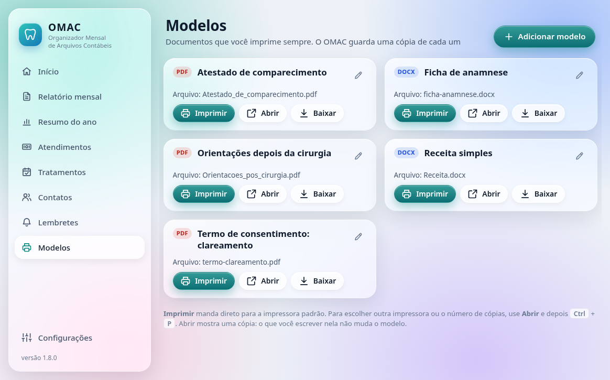
  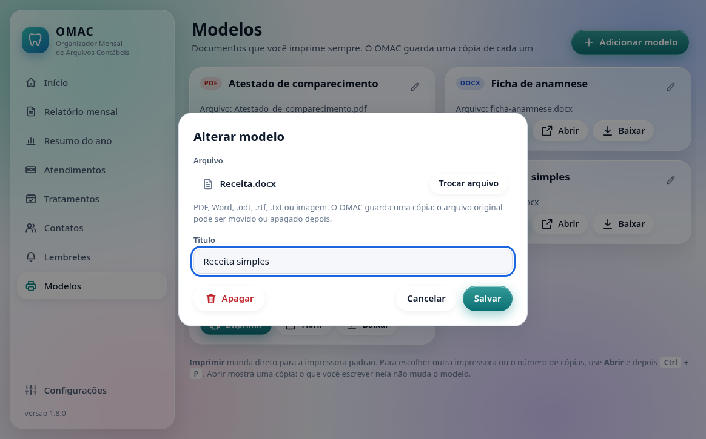
</p>

- **Os documentos que a clínica imprime sempre** (atestado, receita, termo de consentimento, ficha de anamnese): PDF, Word (.docx ou .doc), .odt, .rtf, .txt ou imagem, cada um com um título. O título já vem do nome do arquivo.
- **O OMAC guarda uma cópia** na pasta de dados dele: o arquivo original pode ser movido ou apagado, e os modelos entram no backup.
- **Imprimir** manda direto para a impressora padrão pelo programa do arquivo (Word, leitor de PDF). Se o Windows não souber imprimir aquele tipo direto, o OMAC abre o arquivo e avisa para apertar <kbd>Ctrl</kbd> + <kbd>P</kbd>.
- **Abrir** mostra uma cópia: dá para preencher o nome do paciente sem estragar o modelo. **Baixar** salva uma cópia onde a pessoa escolher.
- **Alterar** troca o título ou o arquivo; **apagar** tem desfazer. No Início, o widget Modelos imprime com um clique.

### Contatos

<p align="center">
  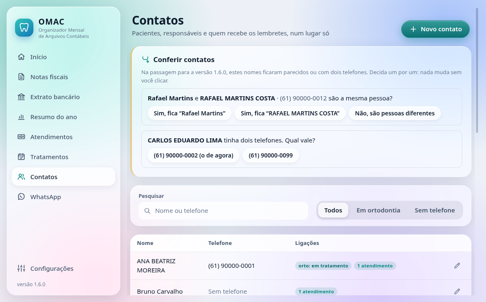
  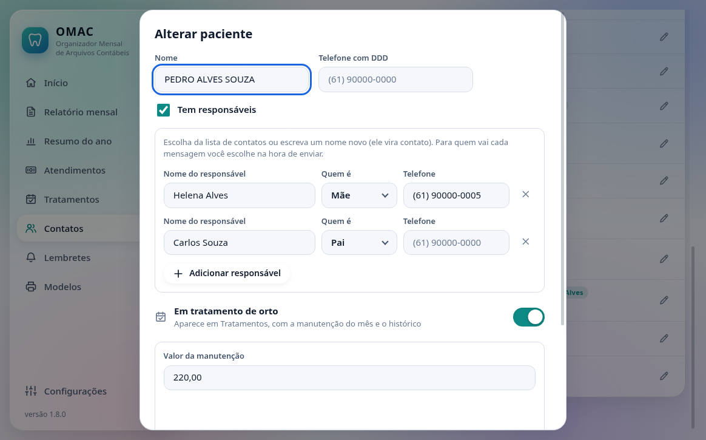
</p>

- **Nome e telefone num lugar só:** pacientes, responsáveis e quem recebe os lembretes. Tratamentos, Atendimentos e WhatsApp usam o mesmo cadastro, então trocar um telefone vale para todo o app.
- **Pesquisa** por nome ou telefone, com filtros (em ortodontia, sem telefone), e **apagar com desfazer**. Quem tem atendimento na ficha não pode ser apagado, para não perder o histórico de pagamentos.
- **Responsáveis:** qualquer contato pode ter responsáveis (mãe, pai, cônjuge ou outro), que também são contatos: escolhe da lista ou cria na hora.
- **CPF:** aceita de qualquer jeito (com ou sem pontos e traço, desde que tenha 11 números), confere os dígitos e mostra sempre como 000.000.000-00. Para quem ainda não tem, o OMAC sugere o CPF que está numa nota já emitida, e só guarda quando a pessoa clica em **Usar este CPF**.
- **Em tratamento de orto:** uma chave na janela de contato põe a pessoa em Tratamentos, com o valor da manutenção e a situação.
- **Conferir contatos:** na passagem para a 1.6.0, nomes iguais se juntam sozinhos; nomes só parecidos (um sobrenome a mais) ou com dois telefones aparecem aqui para decidir com um clique.

### Tratamentos (ortodontia)

<p align="center">
  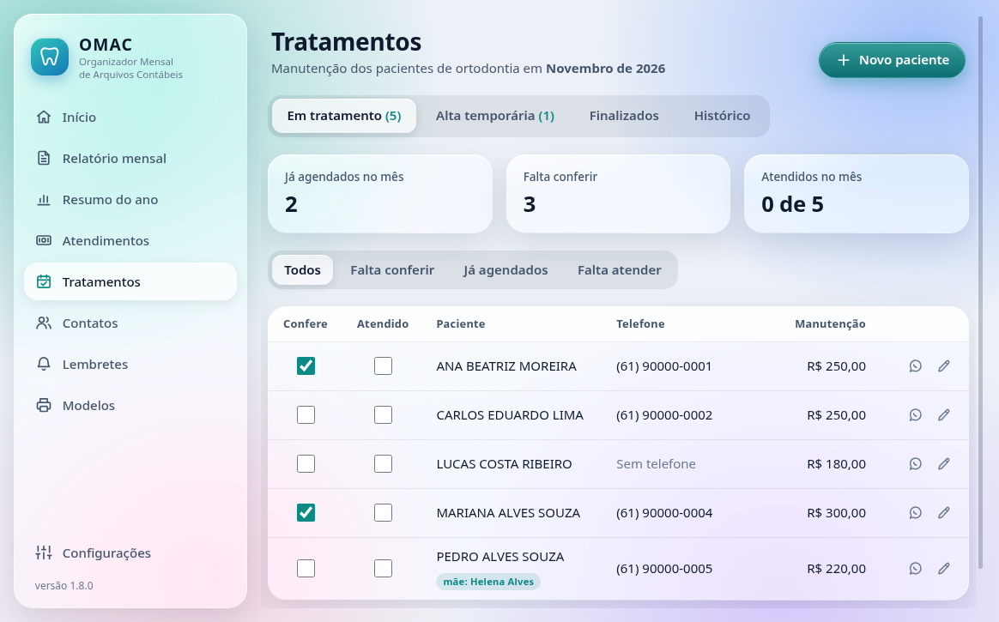
  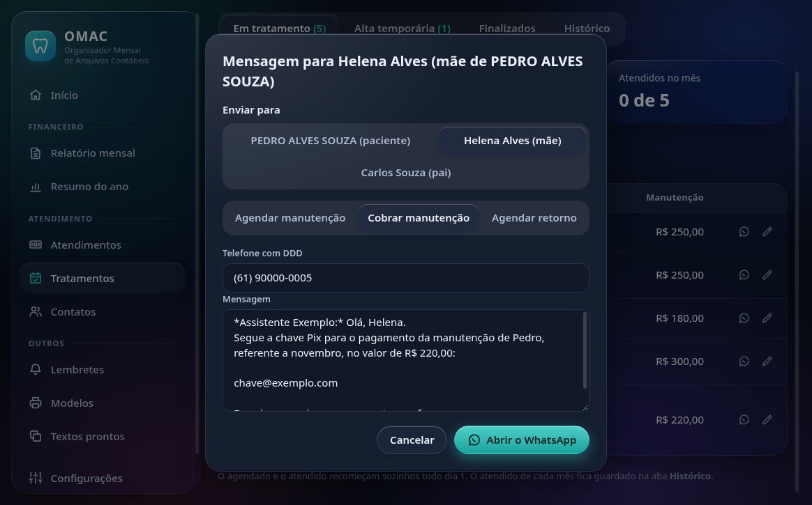
</p>

<p align="center">
  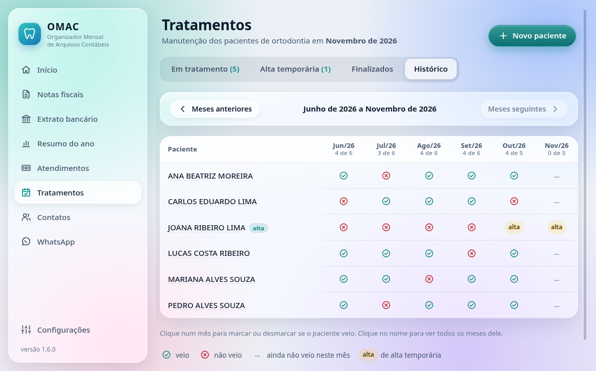
</p>

- **Os pacientes de ortodontia**, com telefone e valor da manutenção. **Novo paciente** abre a janela de contato com a ortodontia já ligada; escrever o nome de quem já é contato abre o cadastro dele.
- **Três mensagens prontas:** agendar a manutenção do mês, cobrar com a chave Pix das Configurações e agendar o retorno. O texto pode ser ajustado antes de abrir a conversa.
- **Para quem enviar** se escolhe na hora: o próprio paciente ou um dos responsáveis. O OMAC lembra a última escolha, e o texto já sai falando com o responsável sobre o paciente.
- **Agendado do mês:** marca quem já está com a manutenção agendada e recomeça sozinho todo dia 1, mesmo que o app esteja fechado nesse dia. Marcar e desmarcar o **Agendado** e o **Atendido** pedem confirmação (Enter confirma), para um clique sem querer não mudar nada.
- **Atendido no mês e histórico:** marque quem já foi atendido. A aba **Histórico** mostra, mês a mês, quem veio, quem não veio e quem estava de alta, e o nome de cada paciente abre o histórico completo dele ("veio em 8 de 10 meses"). Dá para corrigir um mês que passou com um clique.
- **Alta temporária:** com o dia em que foi dada e o dia em que acaba. Enquanto durar, o paciente fica fora da lista do mês, e o OMAC avisa quando a alta termina.
- **Finalizados:** quem termina o tratamento vai para outra aba e pode voltar para a lista se precisar.

### Atendimentos (a ficha do mês)

<p align="center">
  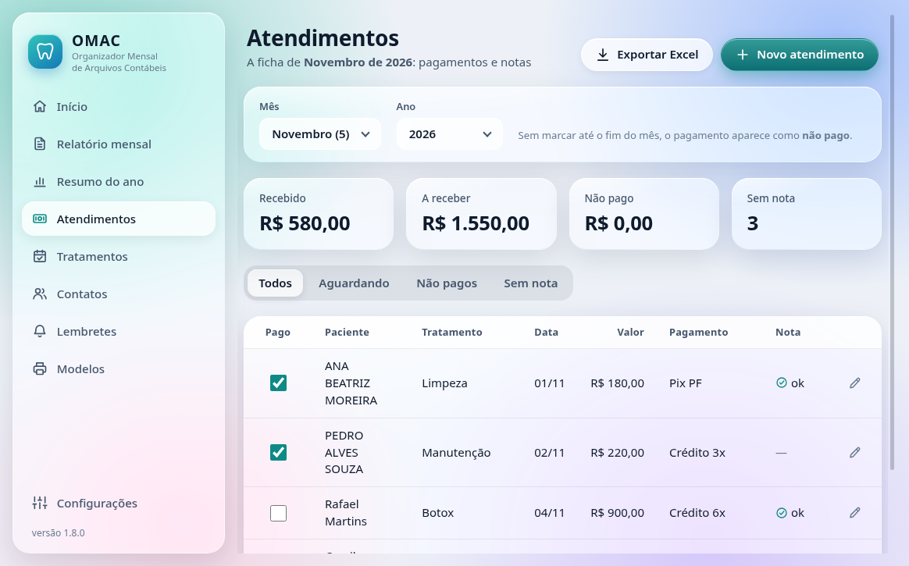
  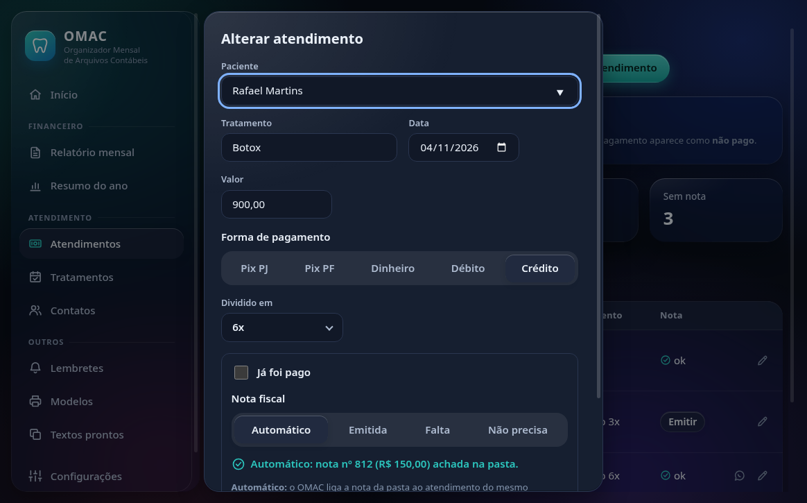
</p>
<p align="center">
  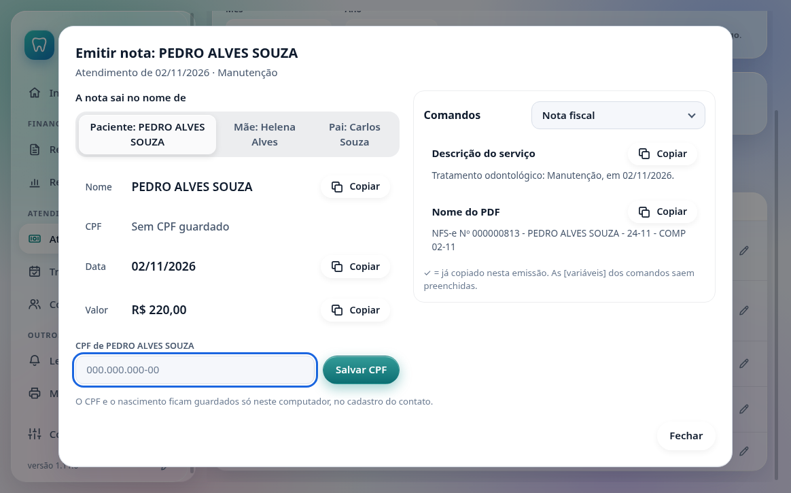
</p>

- **A ficha de papel, dentro do app:** paciente, tratamento, data, valor, forma de pagamento (Pix PJ, Pix PF, dinheiro, débito ou crédito), em quantas vezes no crédito, pago e nota.
- **Pago sem esforço:** fica em branco enquanto espera; se o mês acabar sem marcar, aparece como **não pago**. Pagou depois, é só marcar. Na lista, marcar e desmarcar o pago perguntam antes (*“Marcar o atendimento de Fulano (21/11 · R$ 180,00) como pago?”*), e Enter confirma.
- **Nota em três situações:** **ok** (achada sozinha na pasta, ou marcada como emitida), **falta emitir** e **não precisa**. Dinheiro e Pix PF já sugerem "não precisa", e dá para trocar.
- **Emitir:** onde falta a nota e o atendimento já foi pago aparece o botão **Emitir** (antes de pagar ele não aparece, para não emitir sem querer), que abre uma janela com o nome e o CPF de quem recebe a nota (o paciente ou um responsável, e a última escolha fica guardada), cada um com o botão **Copiar**, e o botão para abrir o site onde a nota é emitida (configurável). Ao lado, os **Comandos** da categoria escolhida (ela fica guardada), com Copiar e um ✓ no que já foi copiado. Nos comandos dá para usar variáveis como `[nome]`, `[cpf]`, `[data-competencia]`, `[valor]`, `[nome-do-dependente]`, `[cpf-dependente]` e `[data-nascimento-dependente]`, que saem preenchidas; se faltar um dado, o OMAC pede antes de copiar. Para o nome do PDF há `[numero-nota]` (o maior número da pasta + 1, com 9 dígitos), `[data-hoje]` e `[comp]` (dia-mês): `NFS-e Nº [numero-nota] - [nome] - [data-hoje] - COMP [comp]`. A data e o valor (só o número, como `180,00`) também têm Copiar.
- **O paciente é um contato:** o campo completa com a lista de contatos; um nome novo vira contato ao salvar. Paciente de ortodontia já vem com a manutenção e o valor.
- **Resumo do mês:** recebido, a receber, não pago e quantos estão sem nota, com filtros. **Exportar Excel:** a ficha do mês em uma folha deitada, pronta para imprimir.

### Backup

<p align="center">
  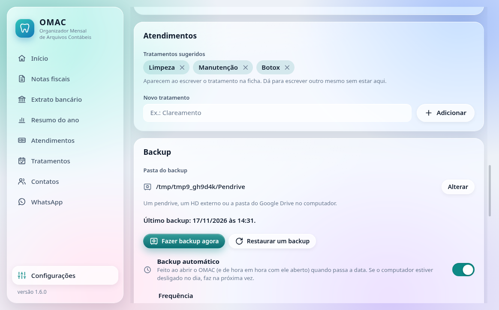
</p>

- **Um arquivo por backup**, `OMAC-backup-AAAA-MM-DD.zip`, com contatos, tratamentos, atendimentos, contas, comandos, modelos (com os arquivos), regras e configurações, mais um manifesto com a versão e a data. Ficam os 12 mais novos.
- **Automático:** todo dia, toda semana (no dia escolhido) ou todo mês (no dia escolhido). É feito ao abrir o OMAC e de hora em hora com ele aberto; se o computador estava desligado no dia, faz na próxima vez.
- **Notas e extratos também (opcional):** cópia para as pastas `Notas` e `Extratos` do backup, só do que é novo ou mudou, sem nunca apagar nada de lá.
- **Restaurar:** escolhe o zip, vê a data e a versão, e o OMAC guarda os dados atuais em `antes-de-restaurar` antes de trocar. Backup de uma versão mais nova que o app é recusado.
- **Falha não trava nada:** pendrive fora ou pasta sumida viram um aviso no Início.

### Interface

- **Visual "Bonito"**, com efeito de vidro líquido, cantos arredondados e temas claro/escuro (ou automático, seguindo o Windows).
- **Visual "Otimizado"**, sem transparências nem animações, para computador fraco. Ele já vem ligado sozinho na primeira vez em PCs com pouca memória.
- **Leve em PC fraco:** voltar a uma tela não desenha tudo de novo quando nada mudou, as pesquisas esperam você parar de digitar, o Início só calcula os cartões que aparecem, e as notas e os extratos já são lidos enquanto a janela abre (a leitura dos extratos fica guardada, então nem a primeira abertura do dia precisa abrir os PDFs).
- **Acessibilidade:** texto de 100% a 200% (também com <kbd>Ctrl</kbd> + <kbd>+</kbd> / <kbd>−</kbd> / <kbd>0</kbd>), alto contraste, opção de reduzir animações, navegação por teclado e leitores de tela.
- **Valores escondidos:** o OMAC sempre abre com os valores como **R$ ----**, para quem passa perto do computador não ver. O botão **Valores**, com o olho, fica no canto de cima de cada tela com dinheiro (Início, Relatório mensal, Resumo, Atendimentos, Tratamentos e Lembretes) e mostra ou esconde todos de uma vez, e depois de alguns minutos sem mexer eles se escondem de novo (o tempo fica nas Configurações).
- **Avisos que minimizam:** a faixa de avisos fica só com a quantidade, sem sumir, e abre de novo com um clique.
- **Aviso de versão nova:** o OMAC avisa e abre o download no navegador. Trocar a pasta do programa não mexe nos dados.
- **Menu lateral em grupos** (Financeiro, Atendimento, Outros), com o nome de cada grupo e uma linha. No lápis, embaixo do menu, dá para arrastar as telas (ou usar as setas ↑ ↓), trocar os nomes, criar e apagar grupos, e voltar ao padrão. Tela nova de uma versão futura entra sozinha no último grupo.

<p align="center">
  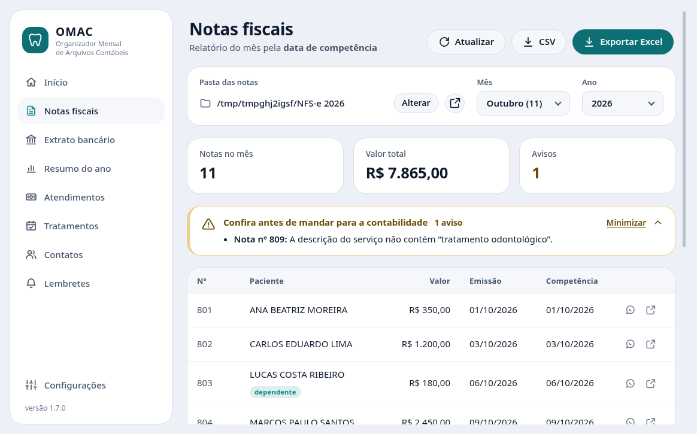
  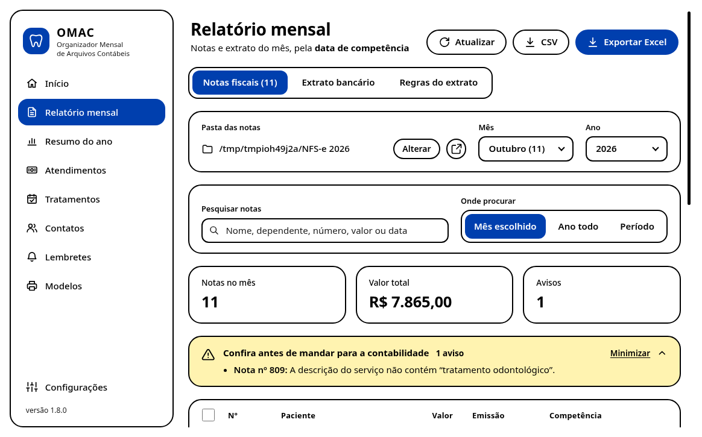
  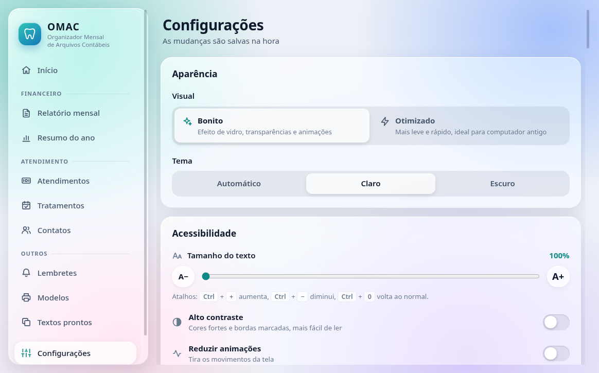
</p>

## Como usar

1. Baixe o `OMAC-64bits.zip` na aba **[Releases](../../releases)**, extraia a pasta e abra o `OMAC.exe` que está dentro. Use o `OMAC-32bits.zip` se o Windows for 32 bits; para conferir, vá em *Configurações → Sistema → Sobre → Tipo de sistema*.
2. Abra o arquivo. Na primeira vez o Windows pode mostrar "O Windows protegeu o computador", porque o app não tem assinatura digital paga. Clique em **Mais informações → Executar assim mesmo**.
3. Escolha a pasta das notas, o mês e clique em **Exportar Excel**.

> Se aparecer um aviso pedindo o **WebView2**, é só aceitar: o próprio OMAC abre a página de download da Microsoft (gratuito). Quase todo Windows 10 atualizado já tem.

### Padrão de nome dos arquivos

```
NFS-e Nº 000000835 - NOME DO PACIENTE - 30-10 -.pdf
NFS-e Nº 000000836 - NOME DO PACIENTE - 03-11 - 31-10.pdf   ← competência diferente (opcional)
```

Número, valor e datas são lidos **de dentro do PDF**. Do nome do arquivo sai só o nome do paciente.

Esse é o padrão, mas cada empresa nomeia de um jeito: em **Configurações → Notas fiscais** dá para escrever o formato com variáveis (`[numero-da-nota]`, `[nome-do-paciente]`, `[data-de-emissao]`, `[data-competencia]`), por exemplo `Nota [numero-da-nota] - [nome-do-paciente]`. O OMAC testa o formato nos arquivos da pasta antes de salvar e mostra quantos entendeu. Ali também fica a **descrição esperada do serviço** (o padrão é "tratamento odontológico"; em branco, não avisa).

## Privacidade (LGPD)

Dados de saúde são dados sensíveis. O OMAC:

- não envia nenhum dado seu para a internet: a única saída é a conversa do WhatsApp que a própria pessoa abre e envia;
- guarda configurações e cache só no computador (`%APPDATA%\OMAC`), em uma pasta separada do programa, que as atualizações não alteram;
- para procurar versão nova, só consulta o GitHub, sem enviar nenhum dado seu, e dá para desligar nas Configurações;
- guarda os contatos (inclusive o CPF), os tratamentos, a ficha de atendimentos e os modelos só no computador, e o backup só na pasta que a própria pessoa escolhe;
- deixa o nome de quem mandou Pix fora da planilha do fechamento;
- guarda as regras do extrato (com nomes de fornecedores) só no computador, nunca no código;
- tem um `.gitignore` que bloqueia PDF, planilhas e extratos, para nenhum dado real ir parar no GitHub.

## Tecnologias

| Parte | Escolha | Por quê |
|---|---|---|
| Lógica | Python 3.12 | leitura de PDF e Excel maduras, fácil de manter |
| Interface | HTML/CSS/JS puro + [pywebview](https://pywebview.flowrl.com/) | usa o WebView2 que já vem no Windows: visual moderno sem pesar como um Electron |
| PDF | [pypdfium2](https://github.com/pypdfium2-team/pypdfium2) | motor do Chrome, ~30× mais rápido que alternativas em Python puro |
| Planilha | openpyxl | gera .xlsx com formatação de moeda, data e total |
| .exe | PyInstaller + GitHub Actions | o executável é gerado e testado num Windows real a cada versão |

## Desenvolvimento

```bash
python -m venv .venv
.venv/bin/pip install -r requirements.txt -r requirements-dev.txt   # no Windows: .venv\Scripts\pip

python -m pytest              # testes
python -m omac                # abre o app
python -m tests.fabrica pasta-de-teste   # cria notas e extratos de exemplo para testar
```

- `tools/capturas.py` regenera as imagens deste README (precisa do `playwright`). Os dados de exemplo são gravados no formato da 1.5.0, então as capturas também passam pela migração.
- `tools/icone.py` regenera o ícone.
- `tools/juntar_tela.py` junta os scripts e os estilos da tela num `omac.js` e num `omac.css` (o `omac.spec` chama sozinho ao gerar o `.exe`; os arquivos-fonte continuam separados em `omac/ui`). Assim a tela pede 3 arquivos em vez de 29 e abre mais rápido, principalmente no 32 bits. Se um script quebrar, a faixa vermelha continua dizendo o arquivo e a linha de verdade.
- `tools/desempenho.py` mede a tela nos 4 modos (visual × reduzir animações) com a CPU 4× mais lenta: quadros travados, tempo de abrir, trocar de tela e do olho. Roda em cada PR e a tabela sai no resumo da execução.

### Gerar uma versão

```bash
git tag v1.0.0
git push origin v1.0.0
```

O GitHub Actions roda os testes, gera o programa de 64 e 32 bits, executa **autotestes do próprio .exe** (notas de exemplo e a tela no WebView2) e publica os `.zip` na aba Releases.

### Publicar uma versão

Mude `__version__` em `omac/__init__.py` e leve para a `main`. O GitHub Actions testa, gera os `.zip` e publica a Release sozinho; na próxima abertura, o app avisa que há versão nova. Um merge sem mudar o número não publica nada.

### Estrutura

```
omac/
├── app.py            janela; a classe Api junta a API de cada módulo
├── nucleo.py         base da API: configurações, diálogos, tratamento de erro, armazém e notas
├── config.py         configurações do usuário
├── sistema.py        coisas do Windows (WebView2, abrir arquivo, PC fraco?)
├── pdf.py            extração de texto de PDF
├── planilha.py       estilo comum das planilhas
├── fechamento.py     planilha do mês, com as abas de cada módulo
├── dados/            arquivo.py · armazem.py · esquema.py · migracoes.py (a única camada que lê e grava)
├── contatos/         contatos.py · api.py
├── tratamentos/      orto.py · mensagens.py · api.py
├── atendimentos/     ficha.py · exportar.py · api.py
├── notas/            leitor.py · pasta.py · servico.py · pesquisa.py · envio.py · exportar.py · api.py
├── extrato/          leitor.py · pasta.py · regras.py · exportar.py · api.py
├── lembretes/        contas.py · livres.py · comandos.py · api.py
├── modelos/          modelos.py · api.py
├── whatsapp/         mensagens.py (telefone, link oficial e textos, usado por todos)
├── backup/           backup.py · api.py
├── resumo/           ano.py · api.py
├── inicio/           registro.py (widgets) · api.py
├── atualizacao/      github.py · api.py
└── ui/               index.html, estilo.css, nucleo.js + um .js/.css por módulo
tests/                testes + gerador de notas e extratos de exemplo
```

**Dados** (`%APPDATA%\OMAC`): `config.json`, `contatos.json`, `tratamentos.json`, `atendimentos.json`, `lembretes.json`, `notas-enviadas.json`, `comandos.json`, `modelos.json` (e a pasta `modelos/` com os arquivos), `regras-extrato.json`, `cache-notas.json` e `cache-extratos.json` (os dois caches são descartáveis e ficam fora do backup). Regras:

- só `omac/dados` lê e grava arquivos; os módulos pedem ao armazém, que guarda cada arquivo em memória e só lê de novo se ele mudar no disco;
- todo arquivo tem `"versao"`; mudar o formato = subir a versão em `esquema.py` e escrever um passo em `migracoes.py` (com teste). Campo novo com valor padrão não precisa de migração;
- ligação entre arquivos é sempre por id; o nome de uma pessoa só existe em `contatos.json`;
- a situação sai das datas: nada é regravado na virada do mês.

Para criar um módulo: uma pasta em `omac/` com a classe da API (herdando de `ApiBase`), que entra na lista de `Api` em `app.py`, e um `.js` em `ui/` que se registra em `modulos` e `acoes` (e entra no `index.html`). Os scripts da tela dividem o mesmo espaço de nomes: duas funções com o mesmo nome em arquivos diferentes também se apagariam, e outro teste confere isso. Os métodos de cada módulo levam o nome dele (`atendimentos_listar`, `_lista_ficha`…): como todos viram uma classe só, dois métodos com o mesmo nome se apagariam sem erro, e um teste confere isso. Para ter um widget no Início: `@widget("id", "Título", ordem=…)` no método que monta os dados e `registrarWidget("id", {…})` no `.js`.

## Próximos passos

- [x] **Extrato bancário:** leitura do PDF do Inter, regras editáveis e fechamento do mês.
- [ ] **Conciliação:** cruzar Pix recebidos com notas emitidas.
- [x] **WhatsApp:** envio de notas e lembretes de contas pelo link oficial.
- [x] **Tratamentos (ortodontia):** pacientes, mensagens, confere do mês e histórico.
- [x] **Ficha de atendimentos** e contas pagas nos lembretes.
- [x] **Tela inicial personalizável** e **resumo do ano**.
- [x] **Contatos únicos**, **base de dados nova** e **backup** (1.6.0).
- [x] **Lembretes e Comandos** (1.7.0).
- [x] **Relatório mensal**, pesquisa de notas, envio de várias notas de uma vez e **Modelos** para imprimir (1.8.0).
- [x] **CPF nos contatos** com a janela **Emitir**, **valores escondidos** e **lembretes que repetem** (1.9.0).
- [x] **Desempenho** sem mudar nada do que a tela faz: listas que só redesenham quando algo mudou, pesquisas que esperam parar de digitar, Início calculando só os cartões que aparecem, tela junta no `.exe`, cache do extrato e leitura das notas e extratos enquanto a janela abre (1.11.0).
- [x] **Nome do PDF da nota** nos Comandos e **Renomear** o PDF baixado com nome de números; confirmação no **Pago**, **Agendado** e **Atendido**; "Confere" virou **Agendado** (1.10.2).
- [x] **Comandos na janela Emitir**, com variáveis, data de nascimento no contato e valor para copiar; **menu lateral em grupos** que dá para organizar; **notas novas lidas sozinhas** ao voltar para o OMAC (1.10.1).
- [x] **Formato do nome das notas** e **mensagem com variáveis** configuráveis, olho no topo das telas e blocos encaixados no Início e nas Configurações (1.10.0).
