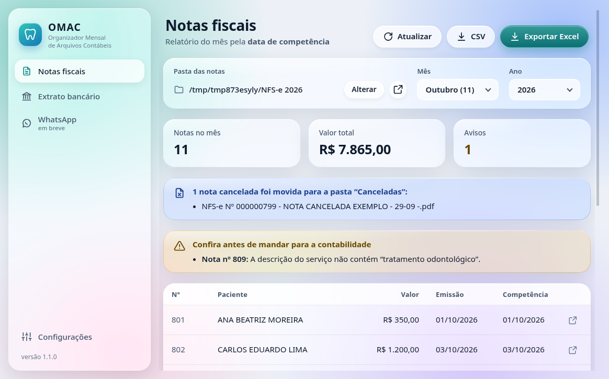
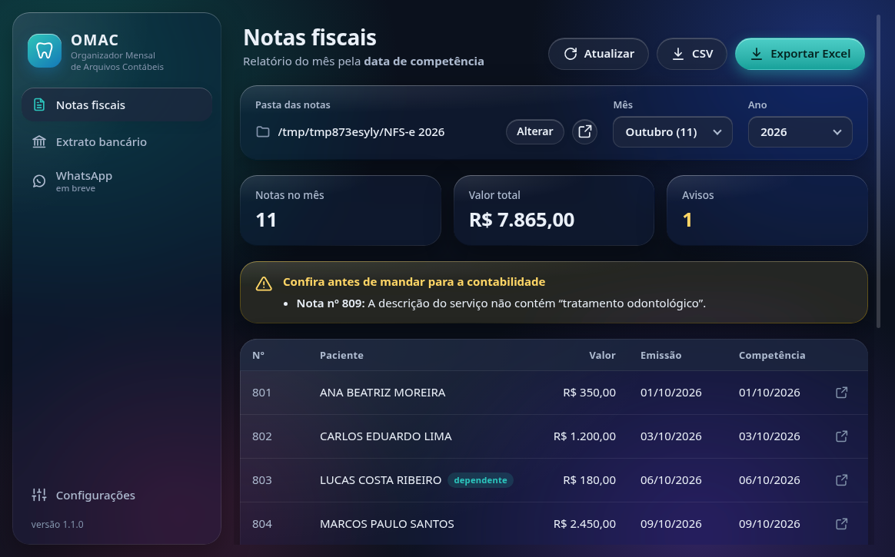
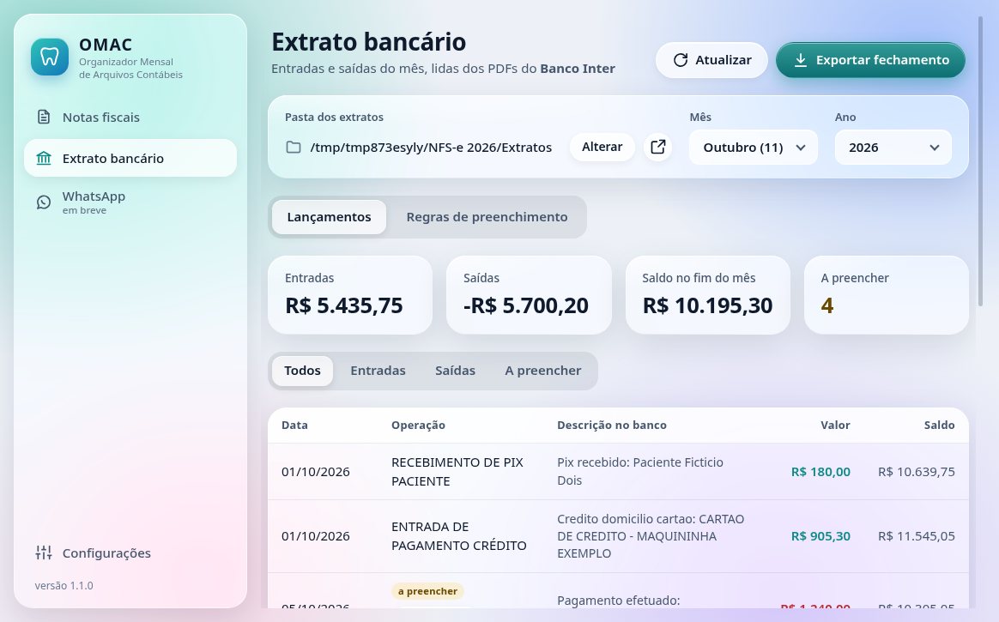
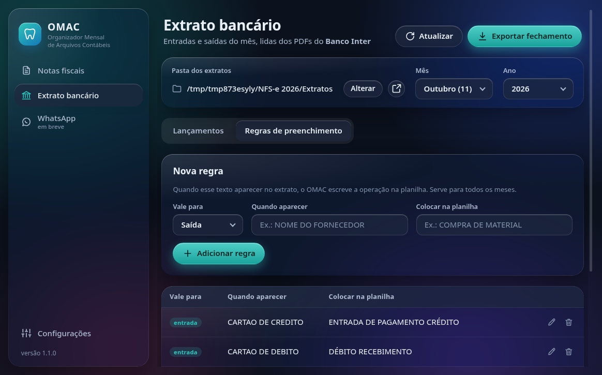
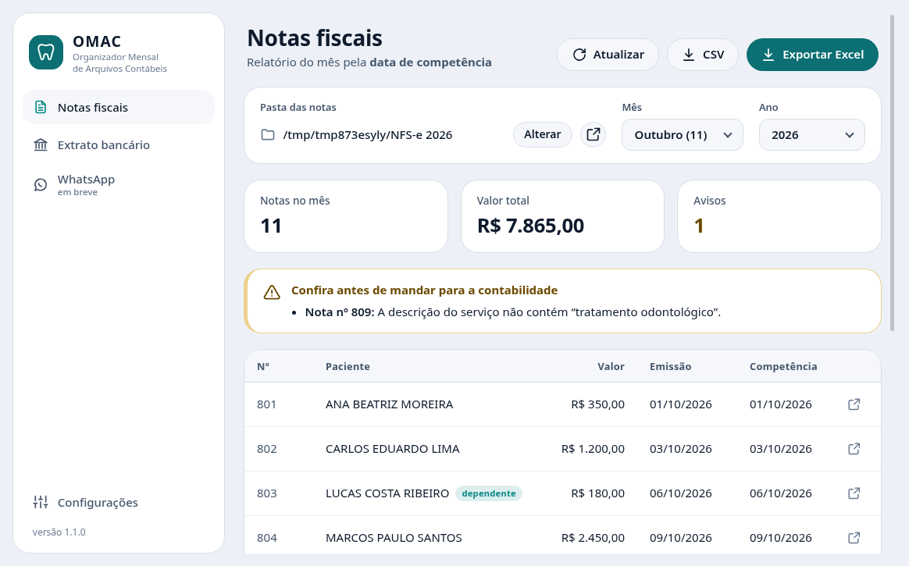
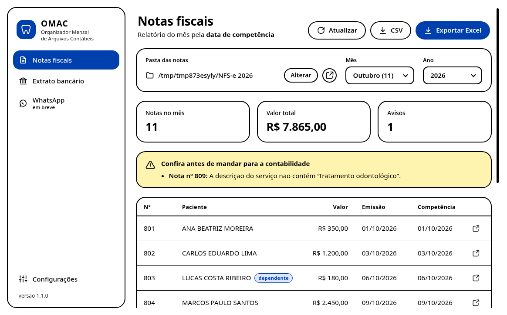
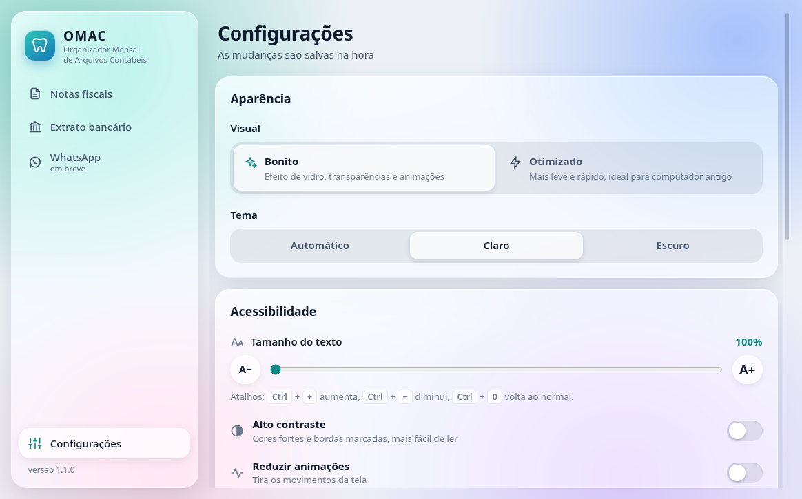

<p align="center">
  
</p>

<h1 align="center">OMAC</h1>
<p align="center"><strong>Organizador Mensal de Arquivos Contábeis</strong><br>
Aplicativo para Windows que automatiza a rotina contábil mensal de uma clínica odontológica.</p>

<p align="center">
  
  
</p>

> Todas as imagens usam **notas de exemplo geradas pelo próprio projeto**. Nenhum dado real de paciente está neste repositório.

## O problema

Todo fim de mês as notas fiscais de serviço (NFS-e) emitidas no ISS do DF e cada linha do
extrato do banco precisavam ser passadas à mão para uma planilha que vai para a contabilidade.

## O que o OMAC faz

### Notas fiscais

- **Lê a pasta de PDFs das notas do ano** (ex.: `NFS-e 2026`) e monta a planilha do mês em um clique, em **Excel (.xlsx)** ou **CSV**.
- **Filtra pela data de competência**, não pela de emissão. Uma nota emitida em 03/11 com competência em outubro entra no relatório de outubro.
- **Nome do paciente:** vem do nome do arquivo. Se a descrição do serviço disser *"tratamento odontológico referente ao dependente FULANO"*, o nome do dependente tem prioridade (caso de nota no CPF do responsável).
- **Notas canceladas** ficam fora do relatório e são movidas sozinhas para a subpasta `Canceladas`.
- **Avisos antes de mandar para a contabilidade:** descrição sem "tratamento odontológico", número do arquivo diferente do número da nota, nota repetida, PDF ilegível, nome de arquivo fora do padrão.
- **Rápido em PC antigo:** cada nota é lida uma única vez (≈5 ms) e fica em cache. Nas próximas vezes, só as notas novas são lidas.

### Extrato bancário

<p align="center">
  
  
</p>

- **Lê os extratos em PDF do Banco Inter** de uma pasta e junta tudo. Se os períodos se repetirem, cada dia vem do extrato baixado por último.
- **Regras "quando aparecer X, colocar Y"** preenchem a coluna Operação. As entradas (Pix, crédito e débito) já vêm prontas; as saídas sem regra ficam em amarelo para preencher, e dá para criar a regra a partir da própria linha.
- **Confere pelo saldo:** cada lançamento é checado com o saldo que o banco informa. Se faltar um período e o saldo tiver mudado nele, o OMAC avisa quanto ficou de fora.
- **Fechamento do mês em um arquivo só:** abas de extrato, notas e resumo por operação, com fórmulas que acompanham o que for digitado depois.

### Interface

- **Visual "Bonito"**, com efeito de vidro líquido, cantos arredondados e temas claro/escuro (ou automático, seguindo o Windows).
- **Visual "Otimizado"**, sem transparências nem animações, para computador fraco. Ele já vem ligado sozinho na primeira vez em PCs com pouca memória.
- **Acessibilidade:** texto de 100% a 200% (também com <kbd>Ctrl</kbd> + <kbd>+</kbd> / <kbd>−</kbd> / <kbd>0</kbd>), alto contraste, opção de reduzir animações, navegação por teclado e leitores de tela.
- **Menu lateral preparado para os próximos módulos** (o próximo é o WhatsApp).

<p align="center">
  
  
  
</p>

## Como usar

1. Baixe o `OMAC-64bits.exe` na aba **[Releases](../../releases)**. Use o `OMAC-32bits.exe` se o Windows for 32 bits; para conferir, vá em *Configurações → Sistema → Sobre → Tipo de sistema*.
2. Abra o arquivo. Na primeira vez o Windows pode mostrar "O Windows protegeu o computador", porque o app não tem assinatura digital paga. Clique em **Mais informações → Executar assim mesmo**.
3. Escolha a pasta das notas, o mês e clique em **Exportar Excel**.

> Se aparecer um aviso pedindo o **WebView2**, é só aceitar: o próprio OMAC abre a página de download da Microsoft (gratuito). Quase todo Windows 10 atualizado já tem.

### Padrão de nome dos arquivos

```
NFS-e Nº 000000835 - NOME DO PACIENTE - 30-10 -.pdf
NFS-e Nº 000000836 - NOME DO PACIENTE - 03-11 - 31-10.pdf   ← competência diferente (opcional)
```

Número, valor e datas são lidos **de dentro do PDF**. Do nome do arquivo sai só o nome do paciente.

## Privacidade (LGPD)

Dados de saúde são dados sensíveis. O OMAC:

- funciona **100% offline**, sem enviar nada para a internet;
- guarda configurações e cache só no computador (`%APPDATA%\OMAC`);
- deixa o nome de quem mandou Pix fora da planilha do fechamento;
- guarda as regras do extrato (com nomes de fornecedores) só no computador, nunca no código;
- tem um `.gitignore` que bloqueia PDF, planilhas e extratos, para nenhum dado real ir parar no GitHub.

## Tecnologias

| Parte | Escolha | Por quê |
|---|---|---|
| Lógica | Python 3.12 | leitura de PDF e Excel maduras, fácil de manter |
| Interface | HTML/CSS/JS puro + [pywebview](https://pywebview.flowrl.com/) | usa o WebView2 que já vem no Windows: visual moderno sem pesar como um Electron |
| PDF | [pypdfium2](https://github.com/pypdfium2-team/pypdfium2) | motor do Chrome, ~30× mais rápido que alternativas em Python puro |
| Planilha | openpyxl | gera .xlsx com formatação de moeda, data e total |
| .exe | PyInstaller + GitHub Actions | o executável é gerado e testado num Windows real a cada versão |

## Desenvolvimento

```bash
python -m venv .venv
.venv/bin/pip install -r requirements.txt -r requirements-dev.txt   # no Windows: .venv\Scripts\pip

python -m pytest              # testes
python -m omac                # abre o app
python -m tests.fabrica pasta-de-teste   # cria notas e extratos de exemplo para testar
```

- `tools/capturas.py` regenera as imagens deste README (precisa do `playwright`).
- `tools/icone.py` regenera o ícone.

### Gerar uma versão

```bash
git tag v1.0.0
git push origin v1.0.0
```

O GitHub Actions roda os testes, gera o `.exe` de 64 e 32 bits, executa um **autoteste do próprio .exe** com notas de exemplo e publica tudo na aba Releases.

### Estrutura

```
omac/
├── app.py            janela; a classe Api junta a API de cada módulo
├── nucleo.py         base da API: configurações, diálogos, tratamento de erro
├── config.py         configurações do usuário
├── sistema.py        coisas do Windows (WebView2, abrir arquivo, PC fraco?)
├── pdf.py            extração de texto de PDF
├── planilha.py       estilo comum das planilhas
├── fechamento.py     planilha do mês, com as abas de cada módulo
├── notas/            leitor.py · pasta.py · exportar.py · api.py
├── extrato/          leitor.py · pasta.py · regras.py · exportar.py · api.py
└── ui/               index.html, estilo.css, nucleo.js + um .js/.css por módulo
tests/                testes + gerador de notas e extratos de exemplo
```

Para criar um módulo: uma pasta em `omac/` com a classe da API (herdando de `ApiBase`), que entra na lista de `Api` em `app.py`, e um `.js` em `ui/` que se registra em `modulos` e `acoes`.

## Próximos passos

- [x] **Extrato bancário:** leitura do PDF do Inter, regras editáveis e fechamento do mês.
- [ ] **Conciliação:** cruzar Pix recebidos com notas emitidas.
- [ ] **WhatsApp Business:** mensagens prontas de confirmação e lembrete.
